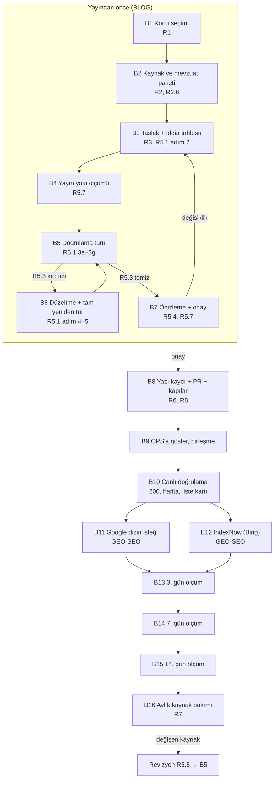

# Rehber Yazısı Standardı (Cetvel) — v0.8 TASLAK

> **Ne yönetir:** Bilgi niyetli teknik yazının (rehber) konusu nasıl seçilir, hangi kaynaktan
> araştırılır, nasıl yazılır, nasıl doğrulanır, Recep'e nasıl sunulur, nerede ve nasıl yayınlanır,
> yayından sonra nasıl ölçülür.
> **Niçin var:** Karar 62 (2026-09-22, ORTA YOL): planlı üretim + Recep onayıyla yayın; akademik ve
> resmî kaynaklı teknik yazılar kapsamda; **kaynak gösterimi zorunlu, uydurma atıf = kırmızı.**
> Tetik ölçüm (OPS, 2026-09-24; bu cetvel için B sınıfı — başkasının ölçümü): bir rakibin tek yazısı
> ("elektrostatik filtre nedir", 2.561 kelime, 17 kaynak) üç günde birinci sayfaya çıktı. VentHub'da
> bugün bilgi yazısı yok ve Search Console'da bilgi niyetli arama **2 gösterim** (R1, A sınıfı).
> **Doğrulama gerekçesi sıralama DEĞİL doğruluktur:** biz sattığımız ürünü anlatıyoruz; yanlış değer
> yanlış satıştır (2026-09-06 vitrin emsali → `vitrin-metni-standard.md`).
> **Sahibi:** BLOG şeridi (karar 93: yazı + arama görünürlüğü). Sayfa, tablo, adres, JSON-LD: URUN
> şeridi. Araç kurulumu ve kapıya bağlama: ALTYAPI. Sıra ve Recep'e götürme: OPS.
> **Kayıt:** REC-369 (F0–F5 iş sırası OPS yorumunda, 2026-09-24).
> **İlgili cetveller:** `vitrin-metni-standard.md` (K1 alan evreni, K2 not deseni, K4.1 olumsuz iddia,
> K10 dil) · `catalog-ingestion-standard.md` §6.3–6.5 (kaynak dizini; PDF açılmaz) ·
> `rendering-cache-standard.md` (§1.1 sessiz dinamikleşme, §2 fiyat yüzeyi, §3 tazeleme) ·
> `canonical-url-standard.md` · `execution-method-standard.md` §5.2 (model seçimi) ·
> `denetim-izi-standard.md` · `db-grant-hygiene-standard.md` · `hukum-kaynak-standard.md` (A/B/C
> kaynak sınıfı) · `adres-semasi-standard.md` (⚠**master'da henüz yok**, açık PR #1339; karar 92
> satırı o cetvele eklenecek).

**Ad notu:** kayıttaki ilk ad `icerik-hatti-standard.md` idi, kullanılmadı. "İçerik hattı" KATALOG'un
aile açıklaması hattının adıdır (`scripts/icerik-hatti/**`, REC-146); iki ayrı iş aynı adı taşımasın.

**Durum:** TASLAK v0.3. v0.1'e iki bağımsız çürütme koşuldu (Fable 5.1 ve Opus 5.5, 2026-09-24; ikisi de
BLOK), v0.2'ye dar ikinci tur (Opus; hüküm KOŞULLU: 35 kalemden 20 karşılandı, 14 kısmen, 1 bilinçli ret).
İkinci turun yüksek bulguları (T2-1…T2-4) bu sürümde; orta bulgular ilgili PR'ların kabul ölçütüne
bağlandı (Ölçüm geçmişi). Yayın, R8'deki kapılar kendi PR'larında doğmadan yapılmaz.
**v0.4 (2026-09-24):** ilk yazı iki doğrulama turundan geçip onaya sunulduktan sonra kalıbın iki zorunlu
bölümü (fiyatı belirleyen etkenler, teknik sorumluluk notu) eksik çıktı; hiçbir kontrol görmedi, OPS emsal
yazıyla elle kıyaslarken buldu. Recep "görmeden onay yok" dedi. Değişenler: R3 zorunlu bölümler + kalıp
kapısı (R8), sorumluluk notunun sabit ilk cümlesi, R5 girişi ve R5.4 (önizleme şart), R5.7 ara önizleme.
**v0.5 (2026-09-25):** karar 121 (içerik stratejisi) kalıcı kural oldu: R1.4 konu sırası ve içerik türleri;
R2.1'de eski destek sayfası içerikleri kaynak değildir; R0.1 ve R9'da taşınan eski konular yayından kalkar,
sırası gelince sıfırdan yazılır.
**v0.6 (2026-09-25):** MEVZUAT şeridiyle iş bölümü (OPS): R2.6 mevzuat paketi, R5.1 3g mevzuat kontrolü,
AB/TR tarih kuralı.
**2026-09-29 (REC-452, GEO-SEO):** R3.2 ters bağlantı — kategori, aile ve ana sayfadan rehbere yol;
INV-REHBER-TERS-BAGLANTI-1.
**2026-10-11 (BLG-3, OPS hükmü):** R5.7 — onay ara önizlemeyle sorulur, gerçek sayfa yayından sonra
gösterilir (frekans emsali, karar 120/135); "yayına giremeyecek metnin onayı sorulmaz" sınırı korunur ve
ölçülebilir hâle geldi: kimlikler güncel slug'a çözülmeli. Tetik ölçüm: sıra 2 yazısında dört aile kimliği
6 Ekim yeniden adlandırması öncesi slug'la duruyordu (sha256 değişir, R5.5).
**v0.8 (2026-10-13, BLG-11):** R10 yayın akışı — fikirden 14. gün ölçümüne tek şema; her basamakta sahibi,
kapısı ve kaydı; BLG-10 bulgularından çıkan kapı adayları (K0–K5) şemadaki yerleriyle. Yeni kural
getirmez, mevcut R1–R9 ve `yayin-gorunurluk-denetim-standard.md` Y2'yi sıraya dizer; R7'ye bağ eklendi.
Tetik ölçüm: radyal/aksiyel yazısında Google dizin isteği yapıldı, IndexNow yapılmadı (anahtar depoda ve
canlıda 200 iken "yok" sanıldı).

---

## R0 — Kapsam

| Metin | Yöneten cetvel |
|---|---|
| Rehber yazısı: "nedir, nasıl çalışır, nasıl seçilir, nasıl hesaplanır" sorusuna cevap veren, tek konulu, kaynaklı yazı | **bu dosya** |
| **Bugünkü 4 bilgi merkezi konusu** (`air-curtain`, `hava-perdesi`, `hrv`, `jet-fan`; sözlükte `knowledge.topics`, TR+EN 8 adres + merkez 2 adres = 10 canlı adres) | **bu dosya** (R0.1) |
| Ürün/aile açıklaması, blok metinleri, meta alanları | `vitrin-metni-standard.md` |
| Destek süreç sayfaları (SSS, iade, kargo, garanti) | kapsam dışı (süreç metni, teknik yazı değil) |

Rehber yazısı ürün satmaz, soruyu cevaplar; ürüne **bağlantı** verir (R3). Vitrin-metni cetvelinin
K2 (iç not yasağı), K4.1 (olumsuz iddia) ve K10 (dil) maddeleri rehber yazısına uygulanır; K2'nin
**deseni** ise rehbere birebir taşınmaz (R8.2).

### R0.1 Bugünkü 4 konu bu cetveli çiğniyor — onarım, karar değil

Sözlükteki dört konu kaynaksız teknik sayı **taşıyor** ("çıkış hızı 7–9 m/s", "itme kuvveti 50–100 N",
"%70–85 verim"; `hrv` debi adımı ücretli bir standarda — "EN 16798-1/ASHRAE 62.1 aralıkları" — yaslanıyor,
R2.2'nin KAPALI sınıfından sayı alınamaz). `air-curtain` ile `hava-perdesi` aynı adım/tuzak metnini
taşıyor ve ikisi de kendini kanonik ilan ediyor (R1.3 ihlali).

⚠**v0.2 bu sayıların müşteriye "basıldığını" yazıyordu; YANLIŞ** (ikinci tur denetçisi ölçtü, BLOG kodda
doğruladı: [TopicPage.tsx:55-59](../../src/views/knowledge/TopicPage.tsx#L55) çeviri dönüşü dizi değilse
listeyi `[]` yapıyor). Sayılar bugün ne sunucu HTML'inde ne tarayıcıda görünüyor. Müşterinin gördüğü
kusur başka: **iki boş bölüm başlığı** (adımlar, sık hatalar) ve yüklemeden sonra site varsayılanına dönen
sekme başlığı. ⚠**Gizli risk:** listeler onarılırsa kaynaksız sayılar canlıya **ilk kez** çıkar.

Onarım iki adımdır, ikisi de seçenek değildir:
1. **Hemen (taşımayı beklemez, URUN):** kaynaksız sayılar sözlükten silinir; boş bölüm başlıkları
   gizlenir; `air-curtain` → `hava-perdesi` kalıcı yönlendirme.
2. **Karar 92 taşımasında (URUN rota + BLOG içerik):** konular yeni adrese **kaldırılıp yönlendirilir**;
   yeniden yazım R9 ritmine girer (R8.1 sayacı). **10 canlı adresin her biri için hedef yazılır, 404'e
   düşen adres 0.**
3. **Karar 121c (2026-09-25):** Bilgi Merkezi'ne taşınan üç konu da yayından kalkar (URUN); konu sırası
   (R1.4) gelince aynı adreste sıfırdan, kaynaklı yazıyla döner. Taşınan metin yeniden yazımda kaynak
   olarak kullanılmaz (R2.1).

## R1 — Konu seçimi

### R1.1 Kaynaklar ve neyi gösterip neyi göstermedikleri

| Kaynak | Ne söyler | Neyi söyleyemez | Durum 2026-09-24 |
|---|---|---|---|
| Search Console (hizmet hesabı, `scripts/gsc/gsc-token.cjs`) | Google'ın bizi **zaten gösterdiği** aramalar, sıra, tık | Göstermediği aramalar — bilgi yazısı olmayan sitede bilgi talebi **görünmez** | ÇALIŞIYOR; veri 2026-08-28'de başlıyor |
| Google arama önerisi (`suggestqueries.google.com`, ücretsiz) | İnsanların yazdığı sorgular | **Hacim** (sıra hacim değildir) | ÇALIŞIYOR |
| Ads Anahtar Kelime Planlayıcı | Aylık arama hacmi | — | YOK (pazar ölçüm düzeni kol 2) |
| Site içi sonuçsuz arama günlüğü (karar 87) | Sitemizde aranıp bulunamayan | Site dışı talep | URUN kuruyor (henüz depoda yok) |
| Teklif kayıtları, müşteri soruları, Recep'in saha bilgisi | Gerçek alıcının sorusu | Hacim | elle |

⚠**Yokluk kanıt değildir.** F1'de (2026-09-24, A sınıfı) Search Console'da bilgi niyetli sorgu 2
gösterim verdi. Bu "talep yok" demek değil; aynı konular için Google arama önerisi 16 tohumda toplam
93 bilgi niyetli öneri döndürdü (ör. "hava perdesi" tek başına 16). Search Console, yazı yayımlanana
kadar bilgi talebini ölçemez; konu seçimi en az bir **dış** kaynağa dayanır. Sorgu dökümü ve tohum
listesi eski Linear REC-369 BLOG F1 yorumunda; güncel yer Kanban kartı/depo dışı dosya (PUBLIC depoya girmez).

### R1.2 Ölçütler (konu başına tablo, Recep'e özetle gider)

| # | Ölçüt | Nereden |
|---|---|---|
| a | Google bizi o konuda zaten gösteriyor mu (küme gösterimi, sıra) | Search Console, sorgu+sayfa |
| b | Dış bilgi talebi (öneri sayısı; kol 2 gelince hacim) | arama önerisi / Ads |
| c | Katalogda o konuda satılan aile sayısı | DB: `product_families` × `categories` — aile `category_id` **veya** `subcategory_id` ile bağlanır; yalnız etkin kategoriler |
| d | Sitede ilgili hesaplayıcı var mı | `/destek/hesaplayicilar/*` (bugün: kanal, hrv, hava-perdesi, jet-fan) |
| e | Kaynak dizininde üretici belgesi var mı (belge × sayfa) | `sayfalar.jsonl` — yalnız **üretici teknik belgesi** sayılır (R2.1) |

Satılan ailesi olmayan konu (c = 0) yasak değildir ama sıranın sonuna gider: iç bağlantı ve satış
karşılığı yoktur. Bu, rakip emsaliyle bilerek ayrışan bir tercihtir.

### R1.3 Konu başına TEK yazı

Aynı sorguya iki yazı yarışmaz. Yeni konu açılmadan önce Search Console'da sorgu+sayfa kırılımıyla o
küme için mevcut sayfa aranır; varsa yeni yazı değil **o yazının genişletilmesi** (R5.5 revizyonu)
yapılır. Bugünkü ihlal: `air-curtain` ↔ `hava-perdesi` (R0.1).

### R1.4 Konu sırası ve içerik türleri (karar 121, Recep 2026-09-24/25)

**Konu sırası** (kayıt: REC-369 yorumu 2026-09-24):

| Sıra | Konu | Durum 2026-09-25 |
|---|---|---|
| 1 | Frekans konvertörü | doğrulandı; yerel önizlemede Recep'e gösterilecek (karar 120) |
| 2 | Radyal fan mı aksiyel fan mı, fan nasıl seçilir | üç doğrulama turu bitti |
| 3 | Vortice sessiz fanlar | sırada |
| 4 | Korozyona dayanıklı (asit) fanlar | sırada |
| 5 | Isı geri kazanım | sırada; REC-392 (enerji etiketi) bu konuya değer |
| 6 | Çatı fanları | sırada |
| 7 | Banyo fanları | sırada |

Sırayı **yalnız Recep** değiştirir. Hacim ve mevsim verisi (pazar ölçüm düzeni kol 2) geldiğinde BLOG
ölçer, öneriyi OPS götürür; öneri sırayı kendiliğinden değiştirmez. Blog üretimi durmaz.

**İçerik türleri:**

| Tür | Durum | Not |
|---|---|---|
| "Doğrusu ve yanlışı" dizisi (yaygın yanlış + kaynaklı doğrusu) | EVET | yanlış da doğru da kaynağa bağlanır; kaynaksız "yaygın yanlış" yazılmaz |
| Mevzuatı ilk anlatan yazı | EVET | konu listesi MEVZUAT şeridinden gelir; resmî metin R2.1/2'dir, BLOG kendi indirdiği ham metinle doğrular |
| Hesaplayıcıyla birleşen yazı | EVET | R2.5: hesap örneğinin sonucu hesaplayıcıyla aynıdır, bağlantı `vh:hesaplayici/…` |
| Saha deneyimi yazıları, Türkçe iklimlendirme terimleri sözlüğü | SONRA | sözlük Bilgi Merkezi alt kırılımı; bilgi mimarisi kararı TASARIM'dan sonra |
| Tedarikçi yazıları | ŞİMDİLİK YOK | |
| ESP yazısı | MÜMKÜN | üçüncü bir firmanın iç bilgisi ve o firma için yazılmış metin kullanılmaz; farklı açı (ayrıntı Kararlar belgesinde, PUBLIC depoya girmez) |

**Eski içerik** (karar 121c): Bilgi Merkezi'ne taşınan üç eski konu (hava perdesi, otopark jet fan, ısı
geri kazanım) yayından kalkar (URUN); konu sırası geldiğinde aynı adreste **sıfırdan, kaynaklı** yeni
yazıyla döner. Eski metin kaynak değildir (R2.1).

## R2 — Kaynak

### R2.1 Öncelik sırası

1. **Üretici teknik belgesi** — kaynak dizininden okunur (`<ingestor>/kaynak-dizini/sayfalar.jsonl`).
   ⛔PDF doğrudan açılmaz; dizinde yoksa önce dizine eklenir (`catalog-ingestion-standard.md` §6.3, §6.5).
   ⛔**Bayi/ticari belge** (fiyat listesi, teklif, sözleşme) kaynak dizininde dursa da atıf **olamaz**:
   dizinde `ticaret/avensair-fiyat-listesi-2026/…` gibi belgeler var.
2. **Resmî kurum ve mevzuat** — Resmî Gazete, bakanlık, TSE; uluslararası: EPA, DOE, AB mevzuatı.
3. **Akademik ve meslek kuruluşu** — hakemli yayın, üniversite, ASHRAE, REHVA.
4. **Diğer** — sektör yayını. Yalnız bağlam için; **sayı bu sınıftan alınmaz**.

**Kaynak olmayanlar:** rakip sitesi, forum, yapay zekâ cevabı (ChatGPT, Gemini, Perplexity dahil),
kaynağı gösterilmeyen blog, **sitenin eski destek sayfası içerikleri** (karar 121c: sözlükteki
`knowledge.topics` metinleri ve onlardan Bilgi Merkezi'ne taşınan yazılar; Recep 2026-09-25: "çok kaba
bilgiler, faydası yok bize"). Eski metinden cümle, sayı ya da yapı alınmaz; aynı konu yeniden
yazılırken araştırma sıfırdan yapılır.

### R2.2 Erişim sınıfı — açılamayan kaynak atıf alamaz

| Sınıf | Tanım | Ne alınabilir |
|---|---|---|
| **AÇIK** | Tam metin herkese açık | İddia + sayı |
| **ÖZET** | Yalnız özet açık (ör. dergi özeti) | Yalnız özette geçen ifade, atıf özete yapılır |
| **KAPALI** | Ücretli (EN, ISO standart metni, ücretli makale) | Yalnız adı ve kapsamı; **sayı yok** |
| **İÇ-DİZİN** | Üretici teknik belgesi, kaynak dizininde var, herkese açık adresi yok | İddia + sayı; kanıt iç kayıtta (`pdf_hash` + sayfa + alıntı); müşteriye R2.4 biçimiyle |

Metindeki her sayı, birim, oran ve teknik iddia en az bir AÇIK ya da İÇ-DİZİN kaynağa (ya da ÖZET'in kendi
ifadesine) bağlıdır. **Açılmamış kaynak atıf alamaz.** (v0.2'de İÇ-DİZİN sınıfı yoktu; 1. öncelikli
kaynak kendi tanımına girmiyordu — ikinci tur T2-2.)

### R2.3 Alıntı HAM kaynaktan doğrulanır — özetleyici araç kanıt değildir

⛔Ölçülmüş vaka (2026-09-24, bu cetvelin v0.1'i): Google'ın SSS zengin sonucu için "yalnız resmî ve
sağlık sitelerinde gösterilir" alıntısı bir özetleyici araçla (WebFetch — sayfayı küçük bir modelle
özetler) "birebir var" diye doğrulandı. Gerçekte belge adresi **301** ile güncellemeler sayfasına
gidiyordu; alıntı 2023 kaydındaydı ve aynı sayfada *"This feature will no longer appear in Google Search
starting May 7, 2026."* yazıyordu. Bağımsız denetçilerden biri (Fable) de aynı yoldan yanıldı; ham
HTML'i `curl` ile çeken denetçi (Opus) yakaladı.

**Kural:** **alıntının kaynakta geçmesi iddianın doğru ve güncel olduğunu göstermez.** Her atıf için:
1. Ham kaynak çekilir: `curl -sS -o /dev/null -w "%{http_code} -> %{redirect_url}"` (yönlendirme) →
   `curl -sSL` (ham HTML). Özetleyici araçlar keşif içindir, kanıt değildir.
2. Kayıt: ilk adres · son adres · HTTP durumu · yönlendirme zinciri · sayfanın "son güncelleme"
   tarihi · **etiketi soyulmuş metnin** sha256'sı (ham HTML'in hash'i her çekimde değişir — ikinci tur
   ölçtü) · birebir alıntı · erişim tarihi.
3. Alıntının **çevresi** okunur: tarih, "deprecated/removed/no longer" notu, daha yeni bir girdi.
   **Adres başka bir yola taşındıysa** bu en güvenilir bayatlık işaretidir (SSS vakası).
4. Kaynak dizini atfında: `pdf_hash` + sayfa + alıntı (dizin zaten belirlenimci).
5. **Tek kaynak betiktir:** [alinti-dogrula.mjs](../../scripts/rehber/alinti-dogrula.mjs) (normalize tanımı,
   hash, yönlendirme ve bayatlık işareti orada). Sonuç `GECTI` / `INCELE` / `KALDI`; `INCELE` alıntıyı
   düşürmez, çevre metni R5.1 3d'ye gider — kelime sezgisi ayırt etmez (ölçüldü: olağan "pages are added
   or removed" cümlesi de işaret verdi).

### R2.4 Müşteriye görünen atıf biçimi

- Metin içinde numara: `[1]`. Yazının sonunda "Kaynaklar" listesi: yayıncı · başlık · (belge sayfası) ·
  adres · erişim tarihi.
- Üretici belgesi müşteriye **belgenin adı ve sayfasıyla** görünür (ör. "Vortice, AIR DOOR kataloğu,
  s. 12"). Üreticinin herkese açık adresi varsa verilir ve **tercih edilir**. Adresi yoksa atıf yine
  yapılabilir; doğrulanabilirlik iç kayıttadır (R2.3/4) ve bu atıf türü yazı başına sayılıp Recep'e
  giden özette ayrıca belirtilir.
- Dizin yolu, hash ve `[s.41]`, `[DB]`, `[MANIFEST]` biçimleri iç kayıttır, vitrine girmez
  (`vitrin-metni-standard.md` K2/5).

### R2.5 Hesap örneği — girdiler varsayımdır, sonuç hesaplayıcıyla aynıdır

Hesap örneği "kaynaksız sayı yok" kuralıyla çelişmez, çünkü girdiler iddia değil **varsayımdır**:
metinde "örnek varsayım" diye işaretlenir (ör. "7.200 m³'lük bir otopark varsayalım"). Formül ve
katsayılar kaynaklıdır (R2.2). Sonuç sitedeki ilgili hesaplayıcının aynı girdiyle verdiği sonuçla
**aynı** çıkmalıdır; farklıysa ya yazı ya hesaplayıcı yanlıştır ve yayın durur.

### R2.6 Mevzuat iddiası MEVZUAT şeridinin paketinden gelir (OPS iş bölümü, 2026-09-25)

Teknik mevzuat ve standart kaydının sahibi MEVZUAT şerididir. BLOG yönetmelik yorumlamaz.

| # | Adım | Sahibi |
|---|---|---|
| 1 | Her yazıdan **önce** konu ve ürün aileleri MEVZUAT'a bildirilir; MEVZUAT **mevzuat paketi** verir: yürürlükteki metin, AB/TR farkı, geçiş tarihleri, birebir alıntı | BLOG ister, MEVZUAT verir |
| 2 | Yazıdaki her mevzuat iddiası (`tur: mevzuat`) yalnız paketten yazılır; pakette olmayan önce MEVZUAT'a sorulur. Araştırma ajanları mevzuat eksenini ayrıca araştırmaz | BLOG |
| 3 | Yazı bitince mevzuat cümlelerini MEVZUAT kontrol eder; bu, R5.1 akışının bir adımıdır (3d'ye ek, onun yerine geçmez) | MEVZUAT |
| 4 | Kayıtta değişiklik olunca MEVZUAT yayındaki yazı için "güncelle" bildirir → R5.5 revizyonu | MEVZUAT bildirir, BLOG yazar |
| 5 | "Mevzuatı ilk anlatan" yazı adaylarını MEVZUAT önerir; sırayı Recep belirler (R1.4) | MEVZUAT / Recep |

**Tarih kuralı:** AB ile TR ayrı takvimdedir (ör. fan tebliği TR'de 24.7.2027'de yürürlüğe girer, o güne
kadar eski tebliğ geçerli). Bir TR tebliğinin kendi metninde basılı AB tarihi AB metniyle çelişirse AB
tarihi AB metninden yazılır; çelişki MEVZUAT paketinde belirtilir (MEVZUAT bulgusu, SGM 2021/16).

## R3 — Yazı kalıbı

Kalıp rakip ölçümünden (n = 1) çıkarıldı; bu yüzden **sayı hedefi değil ölçüttür**: konunun yan
soruları (R1'deki arama önerileri + SSS) cevaplandı mı. Kelime sayısı ve H2 sayısı hedef değildir.

**Zorunlu bölümler (kapı: `scripts/rehber/rehber-denetim.mjs` → `kalipDenetle`, R8.1):** tek H1 · en az
bir tablo · başlığı birebir `## Fiyatı belirleyen etkenler`, `## Sık sorulan sorular` (5–8 `###` soru),
`## Kaynaklar`, `## Teknik sorumluluk notu`. Başlık metni sabittir çünkü kapı başlığı birebir arar;
"Fiyatı neler belirler?" gibi bir varyant kırmızı verir. Gövdenin geri kalanı konuya göre serbesttir.
⚠**Niçin kapı (2026-09-24):** ilk yazı bu iki bölüm olmadan iki doğrulama turundan geçti ve onaya
sunuldu. Doğrulama iddiaları sınar, kalıbı sınamaz; eksik bölüm doğrulayıcının göreceği bir iddia
değildir. Fark ancak emsal yazıyla elle kıyasla bulundu (OPS).

| Bölüm | Kural |
|---|---|
| H1 | Aranan soru ya da konu adı |
| Doğrudan cevap | İlk 2–3 cümle sorunun cevabı; giriş cümlesi yok |
| Gövde | Konuya uyan bölümler: nedir / nasıl çalışır · türleri · uygulamalar · seçim ve boyutlandırma · hesap örneği (R2.5 + hesaplayıcı bağlantısı) · alternatiflerle kıyas · montaj · bakım · güvenlik ve mevzuat · fiyatı belirleyen etkenler · izlenecek yol. Her yan soru bir bölüme bağlanır |
| Tablo | En az bir (kıyas ya da boyutlandırma); hücreler de iddiadır (R5.1) |
| Fiyat | **Rakam yok.** "Fiyatı belirleyen etkenler" bölümü etkenleri anlatır; fiyat yalnız ürün sayfasında görünür (`rendering-cache-standard.md` §2) |
| SSS | 5–8 soru; her cevap tek başına anlamlı (okuyucu için; işaretleme için değil — R6) |
| İç bağlantı | İlgili ürün aileleri (kart, fiyatsız) · ana kategori · varsa hesaplayıcı. Ters yön (kategoriden ve aileden yazıya, ana sayfadan en yeni yazılara) **R3.2**'dedir. **Adres değil kimlik yazılır** (v0.4, Recep 2026-09-24: "URL değişirse sorun olmaz mı?"): metinde `[metin](vh:<tür>/<anahtar>)`, tür ∈ model · aile · kategori · marka · hesaplayici · sayfa; anahtar (URUN ile kesinleşti, 2026-09-24) model için **SKU** (harf duyarsız), kategori için **kanonik EN slug** (CLAUDE.md kural 7), aile için **aile slug'ı** — slug Faz 1-B'de değişirse çözücü `url_takma_adlari` tablosuna bakar. Sayfa üretilirken kimlik `adresUret` ile **güncel** adrese çözülür; **çözülemeyen bağlantı derlemeyi düşürür** (URUN). Metne düz site adresi (`/tr/…`, `https://venthub.com.tr/…`) yazılmaz. Niçin: adres ağacı tek yayında değişecek (`docs/plans/rec-adres-agac-tek-yayin-2026-09-07.md`); eski adres kırılmaz, 308 verir, ama her tıklama bir durak daha yapar ve yazı eski adresi kalıcı taşır. Şablonun kendi kartları ve teklif bağlantısı da aynı çözücüyü kullanır |
| Kaynaklar | R2.4 |
| Teknik sorumluluk notu | `## Teknik sorumluluk notu`, Kaynaklar'dan sonra, yazının içinde (doğrulamadan ve sha256'dan geçsin diye sözlükte değil). İlk cümle her yazıda aynıdır: *"Bu yazı genel mühendislik bilgisi verir; projeye özel hesabın, üretici kılavuzunun ve güncel resmî metinlerin yerini tutmaz."* Ardından yazıya özgü uyarılar gelir: örnek oranlar kendi sisteminde farklı çıkabilir, kurulum yetkili personelle, yasal bilgi yayın tarihindekidir. Emsal yazının "…garantisi içermez" biçimi alınmaz (ölçüldü): "garanti içermez" vaat desenine takılır; "garantisi içermez" takılmaz ama "içermez" olumsuz iddia sınıfına girer ve kaynaksız cümle kırmızı verir. Aynı koruma "yerini tutmaz", "farklı olabilir" biçimiyle yazılır |
| Tarih | Yayın ve güncelleme tarihi görünür |
| Künye satırı (şablon, URUN) | Başlığın altında: yazar (Kurum: VentHub — kişi adı R3 açık sorusuna bağlı), yayın tarihi, okuma süresi (kelime ÷ 200, yukarı yuvarlanmış dakika). Emsal: "DEA Enerji · 21 Eylül 2026 · 12 dakika okuma" |
| İçindekiler (şablon, URUN) | H2'lerden otomatik, sayfa içi çapalı; "Kaynaklar" ve "Teknik sorumluluk notu" hariç. Metne yazılmaz. İki sütunlu masaüstünde yapışkan, dar ekranda açılır kutu (`
`) — emsalin bir şablonu ve bizim önizleme böyle; tek sütunlu emsal şablonunda yapışkan değil (ölçüldü 2026-09-24) |
| Liste sayfası (URUN) | `/tr/bilgi-merkezi`: tek H1, her yazı bir kart (görsel · kategori · tarih · başlık · özet), yeniden eskiye; **arama kutusu** (tasarım kararı K37-a / U2); kategori süzgeci yazı sayısı artınca. Kendi `<title>`/meta/canonical; JSON-LD en az `BreadcrumbList` (emsal liste sayfasında yok — kopyalanmaz). Mobilde yatay taşma 0 (emsalin yazı şablonunda sayfa geneli ~380 px taşma ölçüldü — kopyalanmaz) |
| İlgili yazılar (şablon, URUN) | Yazının altında aynı kategoriden ya da aynı ürün ailesine bağlı diğer rehber yazıları (kimlikle, iç bağlantı kuralı). **Kaynak: tasarım kararı K37-a / U2** (Linear P-REC-4, 2026-09-06: "Bilgi Merkezi iç tasarımı (içindekiler · arama · ilgili makale · ürün bağı; uydurma başlık yok)"). Emsal yazıların üçünde de yok (2026-09-24 şablon ölçümü); karar bizim tasarımımızdan gelir. İlk yazıda ilgili yazı olmadığı için blok görünmez (boş başlık basılmaz) |
| Teklif çağrısı (şablon, URUN) | Yazının altında tek kutu: iletişim/teklif sayfasına bağlantı, bir cümlelik açıklama. Ürün övgüsü ve vaat yok (R4.2). Emsalde var, v0.3'te kural yoktu (2026-09-24 kıyası) |
| Görsel | **R3.1** (v0.7 taslak): kapak her yazıda; şema metnin anlattığı yapı ya da eğri için; hak, kaynak, alt metin ve doğrulama kuralları orada |

### R3.1 Görsel — kapak ve şema (v0.7 TASLAK; karar 134 ve 135 verildi)

**Tetik (2026-09-25):** Recep ilk yazının ön izlemesini gördü: *"blog gibi, daha kaliteli görünmeli,
kapak resmi bile yok"* (OPS aktarımı). Eleştiri metne değil sunuma. v0.6'da görsel "isteğe bağlı" idi;
emsal yazıların hepsinde kapak var (2026-09-24 şablon ölçümü). Yazı başına ihtiyaç listesi:
`docs/plans/rec369-gorsel-ihtiyac-2026-09-25.md`.

**Ölçülen kısıt (BLOG, 2026-09-25):** `src/lib/bilgiMerkezi/markdown.ts` görsel sözdizimini reddeder
(satır 93, `görsel sözdizimi desteklenmiyor` → derleme düşer); yazı kaydında kapak alanı yok. Aşağıdaki
kurallar şablon desteği gelince (URUN) uygulanır; o güne kadar görsel metne yazılmaz.

| Kural | İçerik |
|---|---|
| **Kapak — KARAR 134 (Recep, 2026-09-25, OPS aktarımı)** | *"Kapak = yazının konusuyla ilgili KENDİ ürün görselimiz (DB `product_images`); konuyla ilgili ürünümüz yoksa kapağı Recep verir (bulunan foto ya da Gemini üretimi)."* Her yazıda bir kapak. Aday seçilirken görsel **açılıp bakılır**: üzerinde yazıyla ilgisiz rozet/damga ya da yazı (ör. sertifika rozeti, "photo non contractuelle") olan görsel kırpılmadan kullanılmaz; eğri/tablo görseli kapak olmaz. Yazıya özgüdür: aynı görsel iki yazıda kullanılmaz. Liste kartında ve `Article` JSON-LD `image` alanında aynı görsel (R6). **KARAR 135 (Recep, 2026-09-25):** yazılar mevcut şablonla yayına girer, görsel yükseltme sonra gelir |
| **Şema** | Metnin anlattığı bir yapı (bölümler, kesit, hava yolu) ya da ilişki (eğri, kıyas) okuru metinden daha hızlı taşıyorsa çizilir. Süs şeması yok: her şema bir bölüme bağlıdır ve o bölümde anılır |
| **Şemadaki her sayı ve etiket iddiadır** | İddia tablosuna satır olarak girer (R5.1); doğrulayıcı şemayı da görür; tuzak şemaya da konabilir. Grafik verisi yazıdaki tablo ya da kaynak sayfasındaki değerle birebir aynıdır; okunan eğriden "göz kararı" değer alınmaz |
| **Kaynak gösterimi** | Şemanın altında tek satır: *"VentHub çizimi; veriler: [n]"* ya da *"Temsilî çizim; ölçekli değildir"*. `[n]` yazının kaynak listesindeki numaradır (R2.4) |
| **Hak (telif)** | Hakkı belgelenmemiş görsel kullanılmaz. Üretici kataloğundaki çizim ya da grafik **birebir kopyalanmaz**; gerekiyorsa verisi kaynaktan alınıp yeniden çizilir ve kaynak gösterilir. Ürün fotoğrafı yalnız sitede o ürün için zaten kullanılan medyadan (hakkı ürün kaydıyla aynı). Başka sitelerden görsel alınmaz. Kapak kaynağı **karar 134** (yukarıda); şemalar VentHub çizimidir |
| **Alt metin** | Zorunlu; görselin **ne gösterdiğini** anlatır (süs kelimesi değil): *"Frekans konvertörünün dört bölümü: doğrultucu, DC ara devre, evirici, kontrol birimi"*. Temsilî görselde alt metin bunu söyler; emsal biçim: *"temsili görsel; ölçekli teknik çizim veya belirli bir ürün modeli değildir"* (DEA, 2026-09-24). Şemadaki yazılar Türkçe, SI birimi, ondalık virgül (R3 üslup) |
| **Teknik** | `<Image>` genişlik/yükseklik (CLAUDE.md kural 10); ekranın üst kısmındaki kapak dışında tembel yükleme; açık ve koyu temada okunur (renk token'ları, kural 8); dar ekranda yatay taşma 0 |
| **Ürün kartı ve iç bağlantı** | Görsel değil ama aynı derste doğdu (2026-09-25): ön izleme betiği önceki yazının elle yazılmış ürün kartlarını taşıdı. Kart ve kategori yalnız yazının `vh:` bağlantılarından türetilir; bağlantı seçilmeden önce kategorideki tüm aileler veritabanından ve katalogdan okunur (R3 "İç bağlantı") |

**Kapı (şablon desteğiyle aynı PR'da, R8.1):** her görselin alt metni dolu · kapak var · şema altı kaynak
satırı var · aynı görsel dosyası iki yazıda yok.

**Emsalden bilerek alınmayanlar (2026-09-24 kıyası):** `TechArticle` türü (Google'ın Article listesinde
yok, R6) · `FAQPage` işaretlemesi (zengin sonuç 2026-05-07'de kalktı, R6) · numarasız, bölüm sonu
"Kaynaklar: …" atıf biçimi (R2.4 cümle düzeyinde numara ister) · cümle düzeyinde kaynağı olmayan
koruyucu olumsuz cümleler (kıyas raporu emsalde 15 koruyucu ifade saydı, B sınıfı: alt ajan; emsalde
metin içi atıf numarası hiç olmadığı için hiçbiri cümle düzeyinde kaynaklı değil; R4.5 olumsuz iddiayı
açık kaynak olmadan yasaklar). Aynı koruma bizde kaynaklı sınırlama cümleleriyle (ör. statik basma
yüksekliği uyarısı) ve teknik sorumluluk notuyla sağlanır.

**Üslup:** sade Türkçe; SI birimleri (m³/h, Pa, kW); ondalık virgül; kısaltma ilk geçişte açılır.
**Dil:** TR önce. `EN_YAYIN` kapalıyken (bugün `false`, EN ağacı `noindex`) **EN yazılmaz ve
`/en/knowledge-hub` rotası üretilmez**: arama getirisi 0, doğrulama maliyeti tam. Bugünkü 5 EN bilgi
merkezi adresi o süre EN kategori/destek karşılığına kalıcı yönlendirilir (R6). Bayrak açılınca EN ayrı yazılır, aynı doğrulamadan geçer; EN yoksa
EN sayfa **yoktur** (başka dile düşme yasak, `vitrin-metni-standard.md` K10).
**Yazar ve yapay zekâ açıklaması — KARAR 106 (Recep, 2026-09-24): yapay zekâ notu KONMAZ.** İmza Kurum
(VentHub); okuyucuyu koruyan şey kaynak beyanıdır: cümle düzeyinde `[n]`, kaynak listesi, teknik
sorumluluk notu. Recep'in gerekçesi: bir çalışmayı mühendise yaptırınca da sayfaya onun kimliğini
yazmıyoruz. Google açıklamayı zorunlu tutmuyor: *"Consider adding these when it would be reasonably
expected"* (developers.google.com/search/docs/fundamentals/creating-helpful-content, ham HTML, erişim
2026-09-24). Emsal ölçümü (BLOG, 2026-09-24, A sınıfı: tarayıcıda işlenmiş sayfa, metin + HTML +
JSON-LD taranarak): emsal yazıda yapay zekâ açıklaması **yok**; yazar `Organization` (şirket adı), tarih
görünür, "gözden geçiren" satırı yok. Sitede geçen tek "yapay zeka" ifadesi alt menüdeki sohbet asistanı
bağlantısıdır, yazıyla ilgili değildir.

### R3.2 Ters bağlantı — yazıya site içinden gelen yol (REC-452, 2026-09-29)

Yayındaki her rehber, bağlandığı her kategori ve aile sayfasından **geri bağlantı** alır; ana sayfa en
yeni rehberlere (en çok 3) doğrudan bağlanır. Bağlantı sunucuda çizilir (ilk HTML'de durur).

| Kural | Nasıl |
|---|---|
| Dizin elle tutulmaz | Kategori/aile → yazı eşlemesi yazının KENDİ kimliklerinden türer: gövdedeki `vh:kategori/…`, `vh:aile/…` + `urunler`. Kod: `src/lib/bilgiMerkezi/tersDizin.ts`. Yeni yazı eklenince bağlantı kendiliğinden gelir |
| Boş blok basılmaz | O konuda yazı yoksa ya da Bilgi Merkezi o dilde kapalıysa (EN, R6) blok hiç çıkmaz |
| Anahtar | Kimliğin yazıldığı slug (kategori = kanonik EN slug, aile = aile slug'ı). Yazı takma adlı eski slug taşırsa ters dizin eşleşmez; yeniden yazımda kimlik güncel slug'la yazılır |
| Kapı | INV-REHBER-TERS-BAGLANTI-1 (`src/lib/bilgiMerkezi/__tests__/tersDizin.test.ts`) — yayındaki frekans konvertörü yazısının kategorisine ve üç Danfoss ailesine döndüğünü de ölçer |

**Niçin (ölçüm, 2026-09-29, A sınıfı):** frekans konvertörü rehberi 09-25'te yayına girdi; 09-27'de
Search Console "Google tarafından bilinmiyor" dedi, 09-29'da aramada yazı değil yalnız liste sayfası
çıktı. Yazıya sitenin içinden bağlanan TEK sayfa listeydi (ana sayfa 0, kategori 0, aileler 0). Bu satır
v0.4'ten beri "URUN'un sayfa işi" diye yazılıydı ama emre bağlanmamıştı — yapılmadı.

## R4 — Yasaklar

1. **Toplu üretim yok.** Google spam politikası: *"Scaled content abuse is when many pages are generated
   for the primary purpose of manipulating search rankings and not helping users."* Örnekleri arasında:
   *"Using generative AI tools or other similar tools to generate many pages without adding value for
   users"* (developers.google.com/search/docs/essentials/spam-policies, ham HTML, "Last updated
   2026-08-28", erişim 2026-09-24). Yazılar tek tek, konu başına araştırılarak üretilir; R5 atlanamaz.
2. **Garanti ve üstünlük vaadi yok** ("en iyi", "%100", "kesin çözüm", "garantili").
3. **Rakip adı ve kötüleme yok.** Kıyas ürün tipleri arasında yapılır, firmalar arasında değil.
4. **Taslak ve editör notu vitrine girmez** (K2 sınıfı; kapı R8.2).
5. **Olumsuz iddia kaynakta açıkça yoksa yazılmaz** ("içermez", "gerekmez"; K4.1). Kaynağın sessizliği kanıt değildir.
6. **Mevzuat hükmü** ("zorunludur", "yasaktır") yalnız resmî metne atıfla ve yürürlük tarihiyle yazılır.
7. **Kişi ve proje adı yok** (müşteri, şantiye, teklif).
8. **Yayından önce metin herkese açık başka bir adreste durmaz.** Depo PUBLIC; taslak, iddia tablosu ve
   doğrulama kaydı yayından önce depoya girmez (veritabanının iç tablosu ya da Kanban kartı/depo dışı dosya).
9. **Google Indexing API kullanılmaz.** Google: *"The Indexing API can only be used to crawl pages with
   either JobPosting or BroadcastEvent embedded in a VideoObject."*
   (developers.google.com/search/apis/indexing-api/v3/quickstart, ham HTML, "Last updated 2026-07-16",
   erişim 2026-09-24). Yazılar site haritası + tazeleme ile duyurulur.
10. **Şirket iddiası ve reklam dili yok** (HRT-46): yazıda firma, kurum, ekip, kuruluş yılı, referans ya da "biz"
    dili ve reklam dili kullanılmaz; tek istisna marka adı VentHub'dır. Aynı kural sözlük metni için
    `i18n-localization-standard.md` §4'te de yazılıdır.

## R5 — Doğrulama (ajanlarda)

Doğruluğu ajan düzeni taşır; Recep'in işi satır satır iddia denetimi değildir. Ama **Recep yazıyı
görmeden onay vermez** (Recep, 2026-09-24: "blog yazısını görmedim, nasıl onay vereceğim, görmeden olmaz").
v0.3'teki "Recep metni satır satır okumaz; özet gider" kuralı bu sözle düzeltildi: özet kalır, yanına
yazının sitedeki görünüşüne yakın önizleme eklenir (R5.4).

### R5.1 Akış

| Adım | Kim | Çıktı |
|---|---|---|
| 1. Araştırma | Sonnet alt ajan × N (konu eksenlerine bölünür) | Kaynak listesi + her kaynaktan ham alıntı + R2.3 kaydı. Alıntı **tek parça ve birebir**; tablo değeri **hücre hücre** (not: satır/sütun başlığı). ⚠Ölçüldü (F4, 2026-09-24): ajanlar parçaları "[...]", " / ", " — " ile birleştirip tablo hücrelerini kendi biçiminde yeniden yazdı — ilk taramada 53 alıntının 22'si kaynakta birebir yoktu. Araştırma çıktısı 3c betiğinden KALDI 0 çıkmadan yazıma geçilmez |
| 2. Yazım | BLOG | Taslak + **iddia tablosu** (her iddia → kaynak no + birebir alıntı + tür: sayı / olumsuz / mevzuat / genel) |
| 3a. Kapsam çıkarımı | Doğrulayıcı, **iddia tablosunu görmeden** | Metnin TAMAMINDAN kendi iddia listesi: gövde, tablo hücreleri, SSS, `<title>`, meta açıklama, JSON-LD `headline`, görsel alt metni, hesap örneği. Yazarın tablosuyla eşlenir; **eşlenmeyen iddia = 0** olmadıkça tur geçersiz |
| 3b. Atıf betiği | belirlenimci betik (BLOG) | Sayı, birim, yüzde, "zorunlu", olumsuz fiil taşıyan her cümlede `[n]` var mı; listede olmayan `[n]` ya da kullanılmayan liste maddesi var mı |
| 3c. Alıntı betiği | belirlenimci betik (BLOG) | Her alıntı ham kaynakta (R2.3) normalize edilerek aranır; bulunamayan = DESTEKSİZ. LLM bu adımı yapmaz |
| 3d. Sınıflama | Doğrulayıcı alt ajan | Her iddia için öneri sınıfı: DOĞRULANDI / DESTEKSİZ / ÇELİŞİYOR / BAYAT (alıntı var ama güncel değil) + gerekçe. Birim/dönüşüm, sayının bağlamı (model mi seri mi), cümle içindeki **her iddia ayrı** (K4.1 vakası), olumsuz iddia için açık ifade, 3c'nin `INCELE` çevreleri. **Hüküm BLOG'dadır** (`execution-method-standard.md` §4: alt ajan yargı vermez) |
| 3e. Sabotaj kolu | BLOG, doğrulayıcı bilmeden | Tuzaklar **metnin KOPYASINA** konur (asıl metin tuzaksız kalır; kopya ile asıl arasındaki farkın yalnız tuzak satırları olduğu betikle gösterilir). Her turda **en az 3 tuzak**; **en az biri** betiklerin yakalayamayacağı türden: alıntısı kaynakta birebir geçen ama bağlamı ya da güncelliği yanlış iddia (SSS vakası gibi). Hepsi yakalanmadıkça tur **geçersiz** (emsal: `vitrin-metni-standard.md` K9.7) |
| 3f. Örnekleme | BLOG | DOĞRULANDI satırlarından en az 3'ü BLOG tarafından ham kaynaktan yeniden açılır. **Örneklenen satırlardan biri yanlışsa tur geçersizdir** |
| 3g. Mevzuat kontrolü | MEVZUAT şeridi (R2.6) | `tur: mevzuat` satırlarının her biri yürürlükteki metne karşı: yürürlük, değişiklik, AB/TR takvimi. MEVZUAT "yanlış" ya da "bayat" derse tur geçersizdir |
| 4. Düzeltme | BLOG | DESTEKSİZ / ÇELİŞİYOR / BAYAT satırlar düzeltilir ya da silinir; tuzaklar çıkarılır |
| 5. İkinci tur | aynı doğrulayıcı | **Tüm metin** 3a'dan yeniden geçer (yalnız değişen satırlar değil: düzeltmede eklenen yeni iddia tabloya girmemiş olabilir) |

### R5.2 Model ve bağımsızlık

Doğrulayıcı **Opus** alt ajanıdır (`execution-method-standard.md` §5.2: çürütme → opus). Ölçüm
(2026-09-24, bu cetvelin v0.1 çürütmesi, aynı talimat iki kol): birleşik 29 gerçek bulgudan Opus 26,
Fable 18; Fable bir bayat alıntıyı "birebir doğru" onayladı; Fable'ın birim fiyatı 2,5 kat (girdi/çıktı
10/50 $'a 4/20 $ /MTok, platform.claude.com fiyat sayfası ham HTML, BLOG ölçümü 2026-09-24). Fable yalnız
ölçülmüş bir kaçırmadan sonra, gerekçesi yazılarak kullanılır.
⚠**Bağımsızlık model farkıyla değil yöntemle sağlanır:** aynı ölçümde farklı model (Fable) yazarla
(Opus) **aynı** hatayı yaptı; farkı ham kaynağı kendisi çekmek yarattı. Bağımsızlık = ayrı bağlam +
3a kapsam çıkarımı + 3c betik + 3e sabotaj kolu. Tek örneklem; ilk iki yazıda kıyas tekrar edilebilir.

### R5.3 Kabul

- Eşlenmeyen iddia = 0 · DESTEKSİZ = 0 · ÇELİŞİYOR = 0 · BAYAT = 0 · açılamayan kaynak = 0.
- Sabotaj kolu N / N yakalandı (N ≥ 3).
- Atıf betiği: numarasız iddia cümlesi 0; metin ↔ liste numaraları birebir.
- K2 sınıfı not 0 (R8.2).

### R5.4 Recep'e sunum

İki parça birlikte gider; biri eksikse sunum yapılmamış sayılır:
1. **Önizleme:** yazının sitedeki görünüşüne yakın, okunabilir sayfa: başlık, tarih satırı, bölümler,
   tablolar, SSS, kaynaklar ve teknik sorumluluk notu yerinde (yapay zekâ notu yok — karar 106).
   Sayfa metnin sha256'sının ilk 12 hanesini gösterir; önizlemedeki metin doğrulanan metinle aynıdır.
   Yer: R5.6 rotası; o gelene kadar R5.7.
2. **Özet**, BLOG penceresinde, düz cümleyle: konu ve neden bu konu (R1.2 tablosu), kaynak sayısı ve
   türleri (adresi olmayan üretici belgesi atfı ayrıca), iddia sayısı ve doğrulanan, sabotaj sonucu,
   bağlanan ürün aileleri, emsal yazıyla kıyasta bilerek alınmayanlar ve gerekçesi, tek soru:
   **"yayınlayalım mı?"**
Onay Recep'in kendi sözüyle ve bu pencerede alınır; başka pencereden aktarılan söz onay sayılmaz.

### R5.5 Durum metne bağlıdır; yayındaki yazı revizyonla güncellenir

| Durum | Geçiş şartı | Kayıt |
|---|---|---|
| taslak | — | — |
| doğrulandı | R5.3 tam **ve** 3b/3c betik çıktıları kayıtlı (tablo gelince geçiş DB kısıtıyla bu kayda bağlanır — kapı yayın geçişindedir, yalnız CI'da değil) | **tuzaksız asıl** metnin sha256'sı + doğrulama raporu + betik çıktıları |
| onaylı | Recep sözü; metnin sha256'sı doğrulananla **aynı** | onay kaydı (kim, ne zaman, hangi sha256) + `admin_audit_log` |
| yayında | onaylı sha256 = yayına giden sha256 | `admin_audit_log` |

Metin doğrulamadan sonra **tek karakter** değişirse durum taslağa düşer. Yayındaki yazı güncellenecekse
canlı satır ezilmez, taslağa da çekilmez: güncelleme **ayrı revizyon** olarak aynı akıştan geçer, onaylanınca
yayındaki sürümün yerine geçer; o ana kadar eski sürüm yayında kalır.

### R5.6 Önizleme

Recep'e giden önizleme yalnız yönetici oturumuyla açılan, `force-dynamic` + `noindex` **ayrı bir
rota**dır. Vitrin rotasına sorgu parametresi (`?onizleme=`) eklenmez: `searchParams` alan sayfa
sessizce dinamikleşir (`rendering-cache-standard.md` §1.1). Dal önizlemeleri kapalıdır ve içerik
zaten veritabanındadır; önizleme için ayrı dağıtım açılmaz. Önizleme **revizyon kimliğini** ve metnin
sha256'sının ilk 12 hanesini gösterir; Recep'in onayladığı metin doğrulananla aynı olmalıdır.

### R5.7 Ara düzen — tablo ve rota gelene kadar (F4)

Bugün prod'da rehber tablosu ve önizleme rotası **yok** (ikinci tur ölçtü). İlk yazı beklemez; yayın bekler:
- Taslak, iddia tablosu, betik çıktıları ve tuzaksız metnin sha256'sı **Kanban kartında (not + depo dışı dosya yolu; eski kayıt Linear REC-369)** tutulur
  (özel; PUBLIC depo değil — R4.8).
- **Onay ara önizlemeyle sorulur; gerçek sayfa yayından sonra gösterilir** (OPS hükmü 2026-10-11; emsal:
  frekans konvertörü yazısı, karar 120 ve 135). Yayın yolu çalışır (`yazilar.ts` → `[yazi]` rotası; frekans
  yazısı canlıda), ama R5.6 önizleme rotası yoktur ve dal önizlemeleri kapalıdır: gerçek sayfa yayından
  önce görülemez. Bu yüzden onay sorusu ara önizleme (aşağıdaki claude.ai sayfası) ve R5.4'ün özetiyle gider;
  önizleme sayfa kabuğunu temsil eder, metin birebirdir. Recep'in "evet"i yayına girme iznidir; yayından
  sonra gerçek sayfa Recep'e ayrıca gösterilir, kabuk ya da görsel farkı varsa ayrı iş olur.
- ⛔**Sınır aynıdır: yayına giremeyecek metnin onayı sorulmaz** (Recep, 2026-09-24: "sayfa yapılmadı, ürün
  bekliyor, hem de 105 bir karar; ya verin ya doğru anlatın" → karar 105 geri çekildi); "senden beklenen"
  diye sunulamaz. Soru gitmeden önce yayın yolunun BU metin için çalıştığı ölçülmüş olmalıdır: bağlantı
  kimlikleri güncel slug'a çözülür (kimlik eskiyse derleme durur; ölçü: son aile/kategori yeniden adlandırma
  migration'ının eski-yeni çiftleri), yayını bloke eden açık karar yoktur ya da tarihi OPS'ta yazılıdır.
  Doğrulanmış metnin sha256'sı soru ile yayın arasında değişirse (bağlantı kimliği güncellemesi dahil) yeni
  sha256 ve fark soruda gösterilir; R5.5 uyarınca durum taslağa düşer, bağımsız tur yeniden koşar.
- Ara önizleme rota gelene kadar **özel bir claude.ai sayfasıdır** (Artifact; varsayılan olarak
  yalnız sahibine açık, arama motoruna kapalı — R4.8'i çiğnemez). Sayfa doğrulanan markdown'dan üretilir,
  sha256'nın ilk 12 hanesini gösterir; metin değişirse sayfa aynı adreste yeniden yayınlanır.
  ⚠Sitenin kendi bileşenleri değildir: yazı düzeni ve metin birebirdir, sayfa kabuğu (menü, alt bilgi,
  ürün kartı) temsilîdir ve sayfada bu yazılır.
- Onaylanan sha256, tablo geldiğinde yazının ilk revizyonu olarak yazılır; farklıysa akış baştan.
- Bağımlı işler (sırasıyla, URUN): karar 92 rotası + rehber tablosu migration'ı (kural 13) → önizleme
  rotası. Hepsi REC-369 (Linear, donuk arşiv) altında izlenmişti; yeni izleme BLOG'un Kanban kartında (karar 219; kart numarası BLOG kartı açınca buraya yazılır).

## R6 — Yer ve teknik gereklilikler (uygulayan URUN)

**Yer — karar 92 (Recep, 2026-09-24):** yazılar `/tr/bilgi-merkezi/<yazi>` ve
`/en/knowledge-hub/<article>` adresinde; çatı `/tr/bilgi-merkezi` · `/en/knowledge-hub`. Taşıma ve sayfa
URUN'da. Adres satırı ve rezerve kelimeler (`bilgi-merkezi`, `knowledge-hub`) `adres-semasi-standard.md`'ye
girer. Bugünkü 10 adres (R0.1) kalıcı yönlendirmeyle taşınır; hedefsiz adres 0.

| Şart | Gerekçe / ölçüm |
|---|---|
| **Rota sınıfı:** `page.tsx` RSC; `force-static` + `generateStaticParams` + `revalidate` yedeği; **`dynamicParams = false` kullanılmaz** (yeni yazı derlemeye kadar 404 verir) | Bugünkü konu rotası `dynamicParams = false` ve sözlükten üretiyor (ölçüldü) |
| **Gövdenin tamamı sunucu HTML'inde** — istemci bailout işareti 0; mevcut `'use client'` `TopicPage` yeniden kullanılmaz; `tests/smoke/ssr-kurallari.ts`'e rehber kuralı | Bugünkü konu sayfalarında adım/hata listeleri sunucu HTML'inde boş, 2 bailout işareti (ölçüldü). "Bot ve ziyaretçi aynı HTML'i alır" ölçütü tek başına yetmez: ikisi de aynı eksik HTML'i alabilir |
| Kanonik ve başlık yalnız RSC `generateMetadata`'dan; **tek** `<title>`; kendi `alternates`'ı (layout varsayılanına düşmez) | Bot karnesi (F1b, 2026-09-24): 28 adreste hreflang ana sayfaya düşüyor, 15 adreste iki `<title>` |
| Gövde markdown; sunucuda, izin listeli etiketlerle render; ayrıştırıcı bağımlılığı `bagimlilik-kararlari.md`'ye satır; biçim tasarım token'larıyla (kural 8) | URUN ile netleşti; ayrıştırıcı bugün depoda yok |
| JSON-LD: `Article` + `BreadcrumbList`; BreadcrumbList **tek kaynaktan** (`buildBreadcrumbJsonLd`) | Google: *"Article objects must be based on one of the following schema.org types: Article, NewsArticle, BlogPosting."* (ham HTML, "Last updated 2026-09-08"). `TechArticle` bu listede yok; schema.org'da Article'ın alt türüdür ve Google'ın alt türü kabul edip etmediği **ölçülmedi** — bu yüzden `Article`. Önerilen alanlar: `author` (`author.name` + `author.url` dahil), `dateModified`, `datePublished`, `headline`, `image` |
| **`FAQPage` işaretlemesi konmaz** | Google SSS zengin sonucunu kaldırdı: *"This feature will no longer appear in Google Search starting May 7, 2026."* (developers.google.com/search/updates, ham HTML). SSS bölümü okuyucu için kalır |
| Site haritasında her yayındaki yazı; `lastmod` = güncelleme tarihi; `alternates` yalnız iki dil de yayındaysa | Bugünkü `sitemap.ts` her satıra koşulsuz tr+en alternates yazıyor |
| `hreflang` yalnız iki dil de varsa; kanonik adres tek | `canonical-url-standard.md` |
| `EN_YAYIN` kapalıyken `/en/knowledge-hub` rotası üretilmez; bugünkü 5 EN bilgi merkezi adresi EN karşılığına kalıcı yönlendirilir; bayrak açılınca rota ve yönlendirme birlikte değişir | R3 dil kuralı; "404'e düşen adres 0" (R0.1) EN tarafında da geçerli |
| Bağlantılar `useLocalizedRoutes` ile (`Routes`'a `bilgiMerkezi` girişi); elle `/tr/` eklenmez | CLAUDE.md kural 7 |
| **Kiracı:** rota kiracıyı `DEFAULT_TENANT_ID`'den çözer (`headers()` değil); önbellek anahtarı `lang` **ve** `tenantId`; `UNIQUE (tenant_id, dil, slug)`; servis DI (kural 2) + `React.cache` (kural 6) | Kural 12; `headers()` rotayı sessizce dinamikleştirir (`rendering-cache-standard.md` §1.1) |
| **Veri ve yetki:** yayındaki metin ile iç veri (iddia tablosu, doğrulama raporu, dizin kanıtı, onay kaydı) **ayrı tablolarda**; ziyaretçi rolü yalnız yayındaki metin tablosunu, yalnız `yayında` satırları okur; durum **dil başına**; yeni tablolarda `anon`/`authenticated` yazma yetkisi REVOKE; ziyaretçi rolüyle üç kollu test (yayındaki okunur · taslak okunmaz · yazma reddedilir) | RLS satırı süzer, sütunu süzmez (`vitrin-metni-standard.md` K1 dersi). Prod `public` şemasında yeni tablonun varsayılan yetkisi `anon=arwdDxtm` (BLOG ölçümü, `pg_default_acl`, 2026-09-24). ⚠**Kural 7 sapması, bilerek:** kural 7 DB çevirilerini JSONB ister; dil başına durum gerektiği için (TR yayındayken EN taslağı sızmasın) metin **dil başına satır** tutulur. Sapma migration PR'ında gerekçesiyle yazılır |
| **Tazeleme, aynı PR'da:** `rendering-cache-standard.md` §3 **ana** tablosuna satır (INV-RENDER-2 §3'ü ilk alt başlıkta keser) + tetik (migration **ve** `scripts/webhook_setup.sql`) + handler dalı + `revalidatePath('/sitemap.xml')`. **Ters yön:** yazıda görünen aile/kategori değişince yazı yolu da tazelenir (§3.1 sorusu) | INV-RENDER-2 tablo listesini §3 tablosundan okur; satırı olmayan yeni tabloyu **görmez** — "tablo gelince otomatik" DEĞİL |
| Migration kural 13 (Recep onayı, URUN penceresi) | Migration merge = prod |

## R7 — Ölçüm (yayından sonra)

Yayın günü ve sonrasındaki sıra, sahip ve kapılar **R10'dadır** (B10–B16); bu bölüm ölçülecek şeyleri
tanımlar. Gün sayıları: 3. gün (B13), 7. gün (B14, aşağıdaki "1. hafta"), 14. gün (B15; ilk gösterim ve sıra).

- **1. hafta:** indekslendi mi (Search Console URL denetimi) + bot karnesi (`scripts/seo/bot-karnesi.mjs`)
  yazı adresinde temiz mi.
- **4 hafta, haftalık:** sayfa bazında gösterim, tık, ortalama sıra; hedef küme sorguları.
- **Aylık kaynak bakımı:** her yayındaki yazının kaynakları R2.3 betiğiyle yeniden çekilir; son adres,
  durum ya da sha256 değişen kaynak → yazı "gözden geçir" listesine; ölü kaynağın iddiası yeni kaynağa
  bağlanır ya da kalkar.
- **Taban:** F1 küme rakamları (Ölçüm geçmişi, A sınıfı). Kıyas aynı sorgu ve aynı gün sayısıyla yapılır.
- Sayısal hedef yazılmadı: 25 günlük, 448 gösterimlik tabanla hedef koymak tahmin olurdu. İlk dört
  yazının ölçümü tabanı oluşturur.
- Sorgu listeleri PUBLIC depoya girmez; depoya yalnız özet sayılar, sorgular Kanban kartına (depo dışı dosya yolu).

## R8 — Kapılar

### R8.1 Her kapı onu gerektiren PR'da doğar

Kapılar "ilk yazıdan önce bir gün" kurulmaz: her kapı, koruduğu şeyi getiren PR'ın içinde doğar
(kural 14) ve en az bir sabotaj koluyla kırmızı yandığı gösterilmeden kapı sayılmaz
(`rendering-cache-standard.md` §3 dersi). Bugün var olanlar: INV-REHBER-DENETIM-1 ve INV-REHBER-ALINTI-1
(`scripts/rehber/__tests__/`, vitest `ci` işinde; betiklerin **kendi** doğruluğunu sınar).
⚠**Betik testleri yazıyı denetlemez.** Yazının kendisi ancak yayın geçişi betik çıktısına bağlanınca
(R5.5, tablo kısıtı) kapı altına girer; o güne kadar ara düzende (R5.7) betikler elle koşar ve çıktıları
Kanban kartına not + depo dışı dosya yolu olarak girer.
⚠**Kapının koştuğu ortam:** DB kapıları (ziyaretçi rolü, durum ↔ sha256) prod'a değil **Supabase dalına**
karşı koşar — tablo ancak merge'ten sonra prod'da olur. SSR kapısı yayında yazı yokken **fikstür yazıyla**
koşar; site haritasından temsilci seçen kapı boş evrende sessiz yeşil verir.

| Kapı | Ne ölçer | Hangi PR'da doğar | Sahip |
|---|---|---|---|
| Atıf betiği (R5.1 3b) | numarasız iddia cümlesi 0; metin ↔ liste birebir | BLOG doğrulama betikleri PR'ı | BLOG |
| Kalıp (R3 zorunlu bölümler) | tek H1; en az bir tablo; `## Fiyatı belirleyen etkenler`, `## Sık sorulan sorular` (5–8 soru), `## Kaynaklar`, `## Teknik sorumluluk notu` var; not sabit cümleyle başlar. **Var** (v0.4, `kalipDenetle`); sabotaj kolu: 09-24 vakasının birebir benzeri iki kırmızı verir, onaya sunulmuş ilk metin (sha f29ab1c35e26) gerçek çalıştırmada aynı iki kırmızıyı verdi | BLOG kalıp kapısı PR'ı | BLOG |
| İç bağlantı — metin (R3) | metinde düz site adresi 0 (mutlak, göreli, çıplak); kimlik biçimi `vh:<tür>/<anahtar>`. **Var** (v0.4, `icBaglantiDenetle`, `denetle` içinde; INV-REHBER-IC-BAGLANTI-1) | BLOG kalıp kapısı PR'ı | BLOG |
| İç bağlantı — canlı (R3) | yayındaki her rehber yazısının gövdesindeki site içi bağlantı **doğrudan 200**; 3xx ve 404 KIRMIZI (yönlendirme izlenmez); yayında yazı yoksa `EVREN-BOS` (çıkış 3), temiz değil. **Betik var** (`scripts/rehber/ic-baglanti-denetle.mjs`, ağlı); ölçüldü 2026-09-24: site haritasında yazı 0 → EVREN-BOS; önizlemenin 5 bağlantısı 200; sabotaj: kök adres 308 → KIRMIZI. **Zamanlı koşu ve adres yayınından (REC-300) sonra koşturma ALTYAPI'da** | BLOG kalıp kapısı PR'ı (betik) · ALTYAPI (bağlama) | BLOG + ALTYAPI |
| Alıntı betiği (R5.1 3c) | alıntı ham kaynakta; son adres/durum/sha256 kaydı | BLOG doğrulama betikleri PR'ı | BLOG |
| Not deseni (R4.4) | K2 sınıfı not 0 (R8.2) | BLOG doğrulama betikleri PR'ı ya da tablo kısıtı (migration PR'ı) | BLOG + URUN |
| Vaat / rakip / fiyat deseni (R4.2, R4.3, R3) | "en iyi", "%100", "garanti"; rakip ad listesi (Kanban kartı/depo dışı dosyadan, depoya girmez); `₺ TL € EUR USD` + rakam = 0 | BLOG doğrulama betikleri PR'ı | BLOG |
| Olumsuz iddia (R4.5) | olumsuz fiilli her cümle iddia tablosunda `tur = olumsuz` + açık alıntı | BLOG doğrulama betikleri PR'ı | BLOG |
| Mevzuat (R4.6) | "zorunlu/yasaktır/yönetmelik" cümlesi → resmî kaynak + yürürlük tarihi | BLOG doğrulama betikleri PR'ı | BLOG |
| Toplu üretim (R4.1) | 7 günde yayına geçen **yeni** yazı sayısı > eşik → KIRMIZI (revizyon sayılmaz; eşik Recep'in ritim tercihidir, öneri 2); her yayında doğrulama + onay kaydı | migration PR'ı (onay kaydı) | URUN + BLOG |
| Durum ↔ sha256 (R5.5) | onaylı/yayında sha256 = doğrulanan sha256 | migration PR'ı | URUN |
| Ziyaretçi rolü (R6) | yayındaki okunur · taslak okunmaz · yazma reddedilir · iç tablo okunmaz | migration PR'ı | URUN |
| Sunucu HTML (R6) | bailout 0; gövde ifadeleri sunucu HTML'inde | rota PR'ı (`ssr-kurallari.ts`) | URUN |
| JSON-LD + site haritası (R6) | `Article` + `BreadcrumbList` tek; haritada; FAQPage yok | rota PR'ı | URUN |
| Tazeleme (R6) | §3 satırı + tetik + handler; **site haritası dalı için INV-RENDER-2'de ayrı kol** (bugün testte "sitemap" 0 kez geçiyor — ikinci tur ölçtü) | migration PR'ı | URUN (+ ALTYAPI kol) |
| Önizleme (R5.6) | ziyaretçi rolüyle 401/404; `noindex` | rota PR'ı | URUN |
| Bot karnesi | yazı adreslerinde hreflang/title/canonical/harita temiz | ALTYAPI kapıya bağlar | ALTYAPI |

### R8.2 K2 deseni rehbere birebir taşınmaz

K2 deseni PostgreSQL sözdizimiyle yazılı (`\m`, `\M` kelime sınırı). JS'e birebir taşınırsa `TODO`
kolu **sessizce ölür** — ölçüldü: `/\mTODO\M/.test('bir TODO var')` → `false`. Ayrıca gövde markdown
olduğu için `> *…*` ve `*(…)*` gibi meşru biçimler K2'de not sayılır (Fable çürütücüsü: 8 örnek
cümlenin 6'sında kırmızı, en az 3'ü meşru — B sınıfı, BLOG yeniden ölçmedi; kapı kurulurken ölçülür). Kapı ya DB kısıtı olarak PostgreSQL sözdizimiyle kalır ya da
JS'e `\b` ile taşınıp **sabotaj koluyla** (bilerek konmuş not kırmızı yanmalı) ve rehbere özgü meşru
biçim listesinin **yanlış pozitif ölçümüyle** birlikte kurulur.

## R9 — Ritim

Orta yol: planlı üretim. Başlangıç önerisi **haftada bir yazı**, ilk dört yazının R7 ölçümü bitene
kadar; sonra ölçüme göre artırılır. Üst sınır R8.1'deki toplu üretim kapısıdır (önerilen eşik 7 günde
2 yeni yazı; revizyon sayılmaz). Karar 92 taşımasında eski konular **kaldırılıp yönlendirilir**, yeniden
yazımları bu ritme ve R1.4 sırasına girer (karar 121: eski metinden alıntı yok, sıfırdan). Ritim ve eşik Recep'in tercihidir; bu satır öneridir.

## R10 — Yayın akışı: yazı fikrinden 14. gün ölçümüne tek şema (BLG-11, 2026-10-13)

**Niçin var.** Yayından önceki kurallar R5.1, R5.7 ve R8.1'de, yayından sonrakiler R7'de ve
`yayin-gorunurluk-denetim-standard.md` Y2'de duruyordu; yayın anından canlı doğrulamaya, dizin isteğine
ve IndexNow'a kadar uzanan halkaları sıraya koyan **tek yer yoktu**. Ölçülen sonucu: ilk iki yazıda zincir elle
kuruldu; radyal/aksiyel yazısında Google isteği yapıldı, Bing/IndexNow yapılmadı ("anahtar yok" sanıldı;
anahtar dosyası `public/` altında, depoda ve canlıda 200 idi). Bu bölüm yeni kural koymaz, **mevcut kuralları
tek sıraya dizer, her basamağa sahibini ve kapısını yazar, eksik halkayı ADIYLA gösterir**.
Çelişirse ilgili R maddesi kazanır (burası haritadır); çelişki bu bölüme düzeltme olarak yazılır.

**Okuma kuralı.** Her basamakta üç şey yazılıdır: kim yapar (SAHİBİ), neyle ölçülür (KAPI) ve nereye
kaydedilir (KAYIT). Kapısı olmayan basamak "kapı yok" diye açıkça yazılır, boş bırakılmaz. **Aday** kapı
yazılmamış kapıdır; var sayılmaz (R8.1).

### R10.1 Şema

| Basamak | Ne yapılır | Sahibi | Kapı (neyle ölçülür) | Olmazsa | Kayıt |
|---|---|---|---|---|---|
| **B1** Konu seçimi | R1.2 ölçüt tablosu; konu başına tek yazı (R1.3); sıra R1.4 | BLOG önerir, Recep sırayı belirler | R1.3 tek yazı/konu. Toplu üretim kapısı (R4.1, R8.1) henüz yok; ritim R9 | konu elenir ya da başka yazıyla birleşir | Kanban kartı (BLG-n) + R1.2 tablosu karta not |
| **B2** Kaynak ve mevzuat paketi | Araştırmacı alt ajan (salt-okuma) kaynakları açar: erişim sınıfı (R2.2), ham alıntı (R2.3); mevzuat iddiası MEVZUAT paketinden (R2.6 adım 1) | BLOG + MEVZUAT | `alinti-dogrula.mjs` KALDI 0; açılamayan kaynak 0 (R5.3) | kaynak elenir, iddia düşer; kaynak yoksa yazı yazılmaz | depo dışı klasör + karta not (R5.7) |
| **B3** Taslak + iddia tablosu | R3 kalıbı; her iddia → kaynak no + birebir alıntı + tür; mevzuat yalnız paketten (R2.6 adım 2) | BLOG | `rehber-denetim.mjs` kırmızı 0 (kalıp, atıf, iç bağlantı-metin, vaat, olumsuz iddia, mevzuat). Adaylar: K0, K0b, K1, K3, K4, K5 (R10.2) | kırmızı 0 olmadan B5'e gidilmez | depo dışı taslak + iddia tablosu + betik çıktısı |
| **B4** Yayın yolu ölçümü | Bağlanan aile ve kategori kimlikleri güncel slug'a çözülür (son yeniden adlandırma migration'ının eski-yeni çiftleri); site içi bağlantı hedefleri canlıda 200; yayını bloke eden açık karar yok | BLOG | R5.7 kimlik şartı; `ic-baglanti-denetle.mjs` (hedefler); açık karar yok | derleme durur; onay sorulmaz (R5.7 sınırı) | karta not: komut + çıktı |
| **B5** Doğrulama turu | 3a kapsam çıkarımı (tabloyu görmeden), 3b atıf betiği, 3c alıntı betiği, 3d sınıflama, 3e sabotaj kolu (tuzak yalnız kopyada), 3f örnekleme, 3g MEVZUAT kontrolü | BLOG (doğrulayıcı alt ajanlar bağımsız; hüküm BLOG'da); 3g MEVZUAT | R5.3: eşlenmeyen 0 · DESTEKSİZ 0 · ÇELİŞİYOR 0 · BAYAT 0 · açılamayan 0 · sabotaj N/N (N ≥ 3) | B6 | karta tur notu: tur no, kırmızı sayısı, tuzak sayısı ve yakalanan |
| **B6** Düzeltme + tam yeniden tur | R5.1 adım 4–5: düzelt, tuzakları çıkar, **tüm metin** yeniden 3a'dan geçer | BLOG | R5.1 adım 5 ("tüm metin"); tur sayacı (R10.3) | tur sayısı 3'ü aşarsa kök sebep notu: her bulgunun hangi aday kapıyla yakalanacağı (R10.2) | karta tur notu |
| **B7** Önizleme + onay | R5.4 iki parça: önizleme (sha256 ilk 12 hane) + düz cümle özet; tek soru "yayınlayalım mı?" | BLOG sunar, Recep onaylar (kendi sözü, bu pencerede) | sha256 doğrulananla aynı; yayına giremeyecek metnin onayı sorulmaz (R5.7) | metin değişirse durum taslak, B5 | durum dosyası + karta onay kaydı (kim, ne zaman, sha256) |
| **B8** Yazı kaydı + PR | Yazı `src/data/bilgiMerkezi/yazilar.ts` kaydına girer (kimlik, konu, `yayinTarihi`, `guncellemeTarihi`, ürün bağları; dil başına slug, özet, `kartOzeti`, gövde); ters bağlantı (R3.2); PR gövdesinde `Kanban:` satırı | BLOG; şablon ya da rota değişirse URUN | PR kapıları (`ci`, `admin-smoke`…); `pnpm test:ilgili`; INV-REHBER-* testleri; migration varsa Recep onayı | kırmızı kapı BLOG yüzeyindeyse düzeltilir; değilse 10 dakika sınırı sonra OPS'a yazılır | PR + karta not |
| **B9** Birleşme | PR birleşmeden önce OPS'a gösterilir; `scripts/hijyen/merge-ritueli.cjs <PR> <dal> --agac=<yol> --merge` | OPS onaylar; ritüeli emri veren pencere koşar | ritüel çıkış 0; `mergeStateStatus` CLEAN; `gh api repos/peckop/venthub-hvac-esite/pulls/<N>/merge` 204 | birleşme yapılmaz; kırmızı kapı B8'e döner | karta PR no + birleşme ölçümü |
| **B10** Canlı doğrulama | Dağıtım bitince: yazı adresi **200**; site haritasında adres, `lastmod` = yayın tarihi; bilgi merkezi liste kartı **tarayıcı bölmesiyle** görülür (ham HTML yetmez); ters bağlantı yerinde; iç bağlantılar doğrudan 200 | BLOG | `curl` 200; harita satırı; `ic-baglanti-denetle.mjs`; `bot-karnesi.mjs` yazı adresinde temiz | düzeltme R5.5 revizyonu; B11–B12 başlamaz | karta not: adres, 200, `lastmod`, liste kartı (tarayıcı). ⚠Kart doğrulayıcısı `curl` ve kabuk operatörünü reddeder: "canlı 200" ölçütü elle işaretlenir, kanıt kart notundadır |
| **B11** Google dizin isteği | Search Console'da URL denetimi ve "dizine eklenmesini iste", yalnız bu adres(ler) | GEO-SEO (SEO-39; Recep'ten ayrıca onay istenmez) | `gsc-url-denetim.mjs`: getirme başarılı, robots engeli yok; istek yapıldı kaydı | günlük istek sınırı → OPS'a tek satır | karta: adres, istek, saat |
| **B12** IndexNow (Bing, Yandex…) | `scripts/seo/indexnow-bildir.mjs` ile yeni adres bildirilir; anahtar dosyası `public/<anahtar>.txt`, depoda ve canlıda 200 | GEO-SEO | gönderim öncesi adres GET 200 ve kanonik kendisi (betik zorlar); IndexNow yanıtı 200/202 | hata → karta + OPS | karta: adres, yanıt kodu |
| **B13** 3. gün | URL denetimi: son tarama, dizin durumu; Bing Webmaster (`bing-webmaster-oku.mjs`) | GEO-SEO | Googlebot getirmiş mi, dizinde mi | dizinde değilse sebep (canonical, noindex, bot erişimi) kartta; düzeltme BLOG'a SendMessage | karta tek satır + sayı |
| **B14** 7. gün | R7 "1. hafta": indekslendi mi + `bot-karnesi.mjs` yazı adresinde temiz + `sayfa-kalite.mjs` | GEO-SEO ölçer, BLOG yorumlar | R7 | sorun varsa R5.5 revizyonu | karta tek satır + sayı |
| **B15** 14. gün | İlk gösterim, tık, sıra (`gsc-sayfa-oku.mjs`); R7 tabanıyla kıyas; haftalık ölçüm (R7 "4 hafta") başlar | GEO-SEO | R7 taban kıyası (aynı sorgu, aynı gün sayısı) | konu kümesi tekrar değerlendirilir (R1) | karta özet sayı; sorgu listesi depo dışı |
| **B16** Aylık kaynak bakımı | Yayındaki her yazının kaynakları R2.3 betiğiyle yeniden çekilir | BLOG | `alinti-dogrula.mjs`: son adres, durum, sha256 değişti mi | "gözden geçir" listesi → R5.5 revizyonu | karta not |

### R10.2 BLG-10 bulgularından çıkan kapılar şemada nerede durur

Kaynak: `docs/audits/blg3-bulgu-tablosu-2026-10.md` (59 bulgu; mevcut kapı hiçbirine hüküm vermedi). Aşağıdaki
adayların **hiçbiri yazılmadı**; "Nerede doğar" sütunu R8.1'e göredir (kapı, koruduğu şeyi getiren PR'da doğar
ve sabotajla kırmızı yanmadan kapı sayılmaz).

| Aday | Ne ölçer | Basamak | Durum | Nerede doğar |
|---|---|---|---|---|
| K0 | Her turda `rehber-denetim.mjs` çıktısı tur kaydına yazılır; uzun mevzuat cümlesinin tabloda parça parça girilmesi alt dizi eşleşmesi nedeniyle yanlış kırmızı vermez | B3, B5 | aday | BLG-7 onarımı (#1791) ya da ayrı kapı PR'ı |
| K0b | `MEVZUAT` deseni tüzük, direktif ve karar numarası kalıplarını (2024/1834, 2014/34/AB) kapsar | B3 | aday (desen bugün "tüzük" ve "direktif" içermiyor, ölçüldü) | BLG-7 |
| K1 | İddia tablosunda zorunlu `kapsam` alanı (seri, model, ortam, uygulama noktası); niceleyici cümlede alıntının aynı kapsamı söylediği gösterilmezse kırmızı | B3, B5 | aday | iddia şeması değişikliği (BLG-10 adım 2 cetvel maddesiyle birlikte) |
| K2 | Mevzuat cümlesinde AB ve TR takvimi ayrı alan; değiştiren tüzük no ve 3g sonucu zorunlu | B3, B5 | aday | `tur: mevzuat` şeması (MEVZUAT ile) |
| K3 | Künye alanları (başlık, yıl, sayfa, madde no, erişim tarihi) kaynak dizini manifestosundan doldurulur; yazı listesi ↔ manifest farkı betikle ölçülür | B3 | aday | BLOG betik PR'ı |
| K4 | Alıntıdaki kesinlik sözcüğü (suggest, can, may, widely, must) Türkçe karşılığıyla sözlükte eşlenir; kesinlik değişimi `INCELE` | B3, B5 | aday | `alinti-dogrula.mjs` INCELE kolu; yanlış pozitif ölçümüyle |
| K5 | `genel` tür yalnız tanım ve akıl yürütme taşır; site kapsamı ve canlı olgu iddiasında `canli_olcum` alanı; öneri fiilinde yan cümle atfı | B3, B5 | aday | iddia şeması + `rehber-denetim.mjs` |

K0–K5'in etiketli satır sayıları yakalayacakları sayı değildir (BLG-10 §6): kapı yazılıp sabotajla sınanana
kadar bu bölümde sayı iddia edilmez. Cetvel maddeleri (R5.1 3d'ye "kapsam" ve "aralık mı ayrık mı" alt
maddeleri, R2.4'e yıl ve madde numarası, R2.6 paketine "kapsam dışı koşulları", R4'e site kapsamı iddiasının
canlı ölçülmesi, R5.1 adım 2'de `genel` türün sınırı) BLG-10 adım 2'de bu cetvele girer; burada tekrar yazılmaz.

### R10.3 Ölçütler

- **Tur sayısı:** üçüncü yazıda B5–B6 toplamı ≤ 3 tur (BLG-3'te 10 tur sürdü). Ölçü, her turun karttaki
  tur notundan okunur. Hangi adayların yazıldığına bağlıdır; yazılmayan aday için ölçü verilmez.
- **Yazı kartının kapanışı:** yazı kartı Done'a B10, B11 ve B12 kayıtları kartta olmadan taşınmaz
  (kanıt: kart notunda canlı 200, Search Console isteği, IndexNow yanıtı). Frekans yazısında bu halka
  eksik kaldığı için bu madde var.
- **Skill:** bu akış `.claude/skills/rehber-yayin` ile yönlendirilir (BLG-11 adım 3); tetiği Türkçe doğal
  ifadelerdir ("yeni yazı", "blog yazısı", "rehber yazısı", "yazı yayınlandı", "yazı yayına çıkıyor",
  "dizine ekle"). Tetiğin gerçekten çalıştığı OPS-124 pilotunda ölçülür; ölçülmeden "çalışıyor" yazılmaz.

### R10.4 Açık noktalar (sahibi belli)

| Nokta | Sahibi | Durum |
|---|---|---|
| B11–B15 metni ve kapıları | GEO-SEO | Bu sürümde BLOG'un okuyabildiği betiklerden ve `yayin-gorunurluk-denetim-standard.md` Y2'den çıkarıldı; GEO-SEO onaylayana kadar **taslak** |
| `yayin-gorunurluk-denetim-standard.md` Y2 "her yeni yazı" satırından R10'a bağ (R7 tarafındaki bağ bu sürümde eklendi) | GEO-SEO (Y2'nin sahibi) | BLOG öneri olarak iletir; Y2'yi BLOG değiştirmez |
| `indexnow-bildir.mjs` tek yeni yazı için kullanılacak kip (`--yalniz-yeni` taban site haritası ve `ADRES_SEMASI_K3B` bayrağı ister) | GEO-SEO | doğrulanmadı; B12'nin komut satırı kesinleşmedi |
| EN yayını (`EN_YAYIN`) açılınca B10–B12 EN adresleri için tekrarlanır | GEO-SEO + URUN | bayrak kapalı, kapsam dışı |

---

## Ölçüm geçmişi

Kaynak sınıfı (`hukum-kaynak-standard.md`): **A** = BLOG'un kendi ölçümü · **B** = başkasının ölçümü, okundu.

| Tarih | Ölçüm | Sınıf | Sonuç |
|---|---|---|---|
| 2026-09-24 | Rakip yazı (OPS) | B | 2.561 kelime · 15 H2 · 8 SSS · 17 kaynak; Türkçe rakipler 433–1.565 kelime, 0 kaynak (REC-369 OPS yorumu) |
| 2026-09-24 | F1 Search Console (BLOG) | A | Veri 2026-08-28'de başlıyor (25 gün): 34 tık · 448 gösterim · ort. sıra 28,0 · sorguda görünen gösterim %50, tık %26 · bilgi niyetli sorgu 2 gösterim |
| 2026-09-24 | F1 konu kümeleri (BLOG) | A | 11 küme; en büyük marka dışı küme 57 gösterim / 0 tık / sıra 44. Küme adları ve sorgular REC-369'da (depoya yalnız özet) |
| 2026-09-25 | Bilgi Merkezi ayrıştırıcısında görsel desteği (BLOG) | A | `src/lib/bilgiMerkezi/markdown.ts` satır 93 görsel sözdizimini reddediyor; yazı kaydında kapak alanı yok (R3.1) |
| 2026-09-24 | F1 arama önerisi (BLOG, 16 tohum × 6 ek) | A | 93 bilgi niyetli öneri; en geniş tohum 16 öneri |
| 2026-09-24 | F1b bot karnesi (BLOG, 45 adres × 5 kimlik) | A | 45/45 adreste beş kimlik aynı HTML; 32 adreste sorun (hreflang düşüşü 28, iki title 15, varsayılan başlık + canonical yok 13) |
| 2026-09-24 | Google belgeleri, ham HTML (BLOG) | A | Article türleri Article/NewsArticle/BlogPosting · SSS zengin sonucu 2026-05-07'de kaldırıldı · spam politikası alıntıları birebir · Indexing API yalnız JobPosting/BroadcastEvent |
| 2026-09-24 | v0.1 çürütmesi, iki kol (Fable 5.1 / Opus 5.5) | A | Birleşik 29 gerçek bulgu: Fable 18, Opus 26, ortak 15; Fable 1 bayat alıntı onayı. v0.2'ye işlendi. Raporlar `docs/audits/rec369-rehber-cetveli-red-team-2026-09-24.md` ve `…-opus-2026-09-24.md` |
| 2026-09-24 | v0.2 dar ikinci tur (Opus) | A | KOŞULLU: 35 kalem → 20 karşılandı, 14 kısmen, 1 bilinçli ret; yeni 4 yüksek (tuzak ↔ sha256, İÇ-DİZİN sınıfı, kapı yayın geçişinde değil, F4 ara düzeni yok) v0.3'e işlendi; v0.2'nin R0.1 olgusu yanlıştı (sayılar görünmüyor, listeler boş). Rapor `…-tur2-2026-09-24.md` |
| 2026-09-24 | Emsal yazı yeniden, tarayıcıda işlenmiş (BLOG) | A | Normal istemci ve Googlebot kimliği aynı 9 kelimelik kabuğu alıyor (dolu hâl yalnız JS sonrası); işlenmiş sayfa 2.561 kelime · 15 H2 · 8 SSS · 2 tablo · 1 görsel · 17 kaynak (EPA, DOE, 2 üretici); JSON-LD TechArticle + FAQPage + BreadcrumbList; yazar Organization; teknik sorumluluk notu var ("…performans, emisyon veya tasarruf garantisi içermez…"); **yapay zekâ açıklaması yok** |
| 2026-09-24 | Emsal blog liste + 3 yazı şablonu, Playwright 1280/390 (BLOG, Sonnet alt ajan) | B | İki ayrı site (deaboyler.com / deaenerji.com), yönlendirme yok; üç yazı üç farklı şablon (JSON-LD Article / TechArticle / BlogPosting, üçünde FAQPage). İçindekiler üçünde var (biri yapışkan); ilerleme çubuğu, paylaşım, yazar kutusu, ilgili yazılar yok; iki yazıda mobil sayfa taşması (scrollWidth 770 / 391); hiçbirinde erişim tarihi ve yapay zekâ notu yok. Tasarım kararı K37-a/U2 bulundu (ilgili makale + arama). Rapor Linear REC-369 |
| 2026-09-24 | Kalıp kapısı ilk yazıya karşı (BLOG) | A | Onaya sunulmuş metin (sha f29ab1c35e26): ZORUNLU-BOLUM-YOK × 2 (fiyat etkenleri, sorumluluk notu); tamamlanmış metin: 0 |
| 2026-10-13 | BLG-3 + frekans yazısı bulgu tablosu, kapı koşusu (BLOG, çürütme turlu) | A | 59 gerçek bulgu; `rehber-denetim.mjs` tur 4–10 taslaklarına koşuldu: 0 bulguya hüküm; `alinti-dogrula.mjs` fonksiyon düzeyi: tur 4 GECTI 114 · INCELE 7 · KALDI 0; tur 4–9'un 41 bulgusundan 35'i 25 Eylül'de doğrulanmış metinde vardı. Rapor `docs/audits/blg3-bulgu-tablosu-2026-10.md` (BLG-10 PR'ı) |
| 2026-09-24 | Alıntı betiği canlı (BLOG) | A | Cetvelin 5 Google alıntısı: GECTI 2 · INCELE 3 · KALDI 0; bayat SSS alıntısı yol değişikliğiyle yakalandı; bayatlık kelimesi olağan cümlede de işaret verdi (ayırt etmez) |

⚠**v0.1'de bu cetvelin kendisi R2'yi çiğnedi:** SSS alıntısı özetleyici araçla "ölçüldü" diye yazıldı ve
bayattı (R2.3 vakası). Kuralı yazmak onu uygulamak değildir; bu sürümün de her olgusal cümlesi aynı
kurala karşı tarandı ve ölçüm geçmişine sınıfıyla yazıldı.
